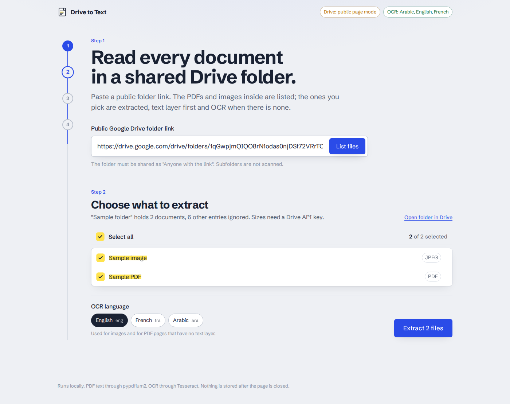
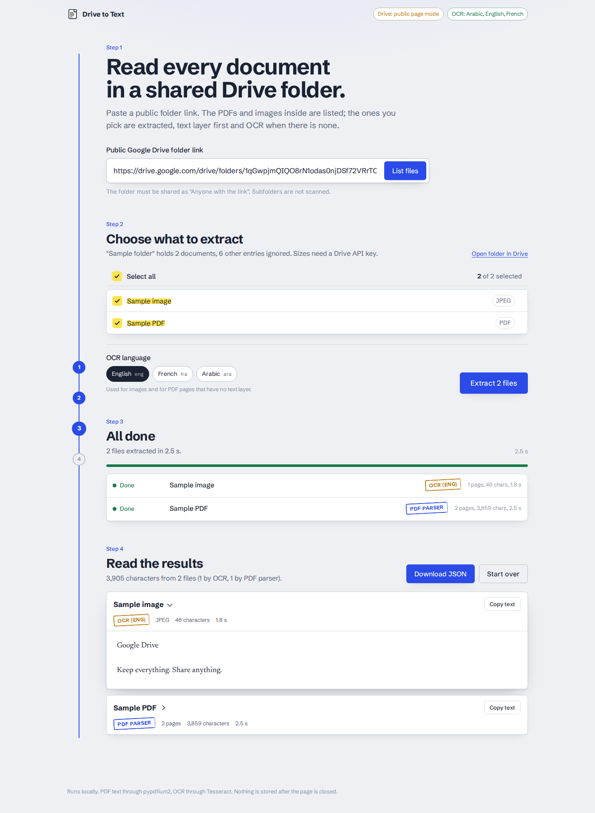

# Drive to Text

A small web application that takes a public Google Drive folder link, lists the PDFs and
images it contains, and extracts their text through the right pipeline: the PDF text layer
for native PDFs, OCR for images and for scanned PDF pages.

Built for the DI Xpertia technical assessment TA-2026-01.



## What it does

1. **Paste a link.** Any public Drive folder URL shape is accepted (`/drive/folders/<id>`,
   `/drive/u/0/folders/<id>`, `/open?id=<id>`, with or without `?usp=sharing`). Private,
   missing or non-folder links produce a specific error.
2. **List the documents.** Only PDF, PNG and JPEG files are kept; name, type and size are shown.
3. **Select files.** Individually or with "Select all". The selection count stays visible.
4. **Run the batch.** Selected files are processed concurrently; each one moves through
   pending, processing, done or failed, streamed live to the page. One failing file never stops
   the others.
5. **Read the results.** Text is shown per file with the method used, the page count, the
   character count and the time taken. The whole batch can be downloaded as JSON.

Bonus items covered: scanned-PDF detection with automatic OCR (per page, so mixed documents
work), asynchronous processing with live progress over Server-Sent Events, Docker in one
command, automated tests for routing and extraction, and OCR language selection (English,
French, Arabic, combinable).

## Architecture

```
browser (static/index.html, app.js)
   |  POST /api/folders        resolve link, list PDFs and images
   |  POST /api/batches        start a batch for selected files
   |  GET  /api/batches/{id}/events   live per-file status (SSE)
   |  GET  /api/batches/{id}/export   JSON download
   v
FastAPI (app/main.py)
   |- app/drive        link parsing, folder listing, download
   |     ApiKeyStrategy     Drive API v3 with an API key (preferred)
   |     PublicPageStrategy keyless fallback that reads the public folder page
   |- app/batch        in-memory batches, bounded concurrency, event stream
   `- app/extraction   routing and the two pipelines
         router        pdf -> pdf_parser, image -> ocr
         pdf_parser    pypdfium2: text layer per page; empty pages are rendered for OCR
         ocr           Tesseract via pytesseract, language selection, image preparation
```

Routing in one picture:

```
drive link -> list files -> user selection -> batch
   |- *.pdf        -> text layer per page
   |     page with text   -> kept as is             (method: pdf-parser)
   |     page without     -> rendered at 200 dpi -> Tesseract   (method: ocr, or mixed)
   `- *.png | *.jpg -> Tesseract                   (method: ocr)
results -> per-file text + status -> page and JSON export
```

A PDF page is treated as scanned when it has fewer than `PDF_TEXT_MIN_CHARS_PER_PAGE` letters
or digits (default 25). That catches image-only scans and pages whose "text" is just a few
stray glyphs, while leaving sparse but real pages (a title page) to the parser.

## Stack and why

| Layer | Choice | Reason |
| --- | --- | --- |
| Backend | Python 3.12, FastAPI | The strongest open-source ecosystem for PDF and OCR work; FastAPI gives typed request models, async I/O for Drive downloads and a clean place for the SSE stream. |
| PDF | pypdfium2 | Wraps Google's PDFium: fast text extraction **and** page rendering in one BSD/Apache-licensed package, no system dependency. PyMuPDF was rejected for its AGPL licence; pdf2image was rejected because it needs the GPL poppler binaries. |
| OCR | Tesseract 5 via pytesseract | Apache-2.0, self-hosted, ships language packs for French, English and Arabic, and runs on a plain CPU inside the Docker image. No paid cloud API is used or needed. |
| Frontend | One HTML page, vanilla CSS and JavaScript | The brief asks for a single page that runs locally. No build step means `pip install` and run; the page is still structured (templates, a small state object, one module). |
| Transport | Server-Sent Events | One-directional progress is exactly what SSE is for; no WebSocket library, works through `EventSource`. |

## Setup

Requirements: Python 3.11+, and Tesseract on your PATH for OCR (`tesseract-ocr` plus the
language packs you want, for example `tesseract-ocr-fra tesseract-ocr-ara` on Debian/Ubuntu,
`brew install tesseract tesseract-lang` on macOS). Without root, download `fra.traineddata` /
`ara.traineddata` from `tesseract-ocr/tessdata_fast` into a folder (with `eng.traineddata`) and
set `TESSDATA_DIR` to it. Native PDFs work without Tesseract.

```bash
git clone https://github.com/AzizBahloul/Drive-to-Text-Document-Extraction-POC.git
cd Drive-to-Text-Document-Extraction-POC
python3 -m venv .venv && source .venv/bin/activate
pip install -e ".[dev]"
cp .env.example .env            # optional, see below
uvicorn app.main:app --reload   # http://127.0.0.1:8000
```

Or with Docker, which bundles Tesseract and the three language packs:

```bash
docker compose up --build       # http://localhost:8000
```

`make install`, `make dev`, `make test`, `make lint` and `make docker` wrap the same commands.

The interactive API reference (Swagger UI, generated from the code) is served at `/api/docs`.

### Google Drive access

The app works in two modes, chosen automatically from `GOOGLE_API_KEY`:

- **Drive API key** (recommended). Create an API key in Google Cloud Console with the
  "Google Drive API" enabled and put it in `.env`. No OAuth, no user login: an API key can read
  anything shared as "Anyone with the link". Listing is exact, paginated and includes sizes.
  The app has been exercised end to end in keyless mode; the API-key path is covered by tests
  against a mocked Google and follows the documented `files.list` / `alt=media` endpoints.
- **Public page mode** (no key). The app reads the public folder view Google serves for shared
  folders. It needs no setup and is good for a demo, but Google does not document that page:
  sizes are not available, very large folders are truncated, and it may break if Google changes
  the markup. The page header shows which mode is active.

### Configuration

All variables are optional. See `.env.example` for the full list and defaults:
`GOOGLE_API_KEY`, `MAX_FILE_SIZE_MB`, `MAX_PARALLEL_FILES`, `OCR_DEFAULT_LANGUAGE`,
`OCR_RENDER_DPI`, `PDF_TEXT_MIN_CHARS_PER_PAGE`, `TESSERACT_CMD`, `TESSDATA_DIR`, `OCR_TIMEOUT_SECONDS`,
`OCR_PAGE_WORKERS`, `MAX_PDF_PAGES`, `FILE_TIME_LIMIT_SECONDS`, `SUBFOLDER_DEPTH`, `MAX_FOLDERS`, `MAX_RUNNING_BATCHES`,
`BATCH_RETENTION`, `ALLOWED_HOSTS`, `HOST`, `PORT`, `LOG_LEVEL`.

### Safety limits

The files come from a folder the user does not control, so they are treated as untrusted:

- A page or image is never decoded or rendered above 60 megapixels. A PDF page may declare
  any size, and a 300-byte file asking for a 14400 x 14400 pt page would otherwise allocate
  gigabytes; such pages are rendered at a reduced scale instead.
- Tesseract is stopped after `OCR_TIMEOUT_SECONDS` per page, a PDF is read up to
  `MAX_PDF_PAGES`, and a file stops after `FILE_TIME_LIMIT_SECONDS`. Each case keeps what was
  extracted so far and says so in the file's warnings.
- At most `MAX_RUNNING_BATCHES` batches run at once (HTTP 429 beyond that), and only the last
  `BATCH_RETENTION` finished batches and 100 folder listings stay in memory.
- The server answers only to the hosts in `ALLOWED_HOSTS` (DNS-rebinding protection), sends
  a strict Content-Security-Policy and related headers, and Docker publishes the port on
  `127.0.0.1` only, because the API has no authentication.
- The Drive API key travels in the `X-Goog-Api-Key` header, never in a URL, so it cannot
  leak into request logs. Error messages shown in the page never include server internals.

## Running the tests

```bash
pytest            # about 155 tests, a few seconds
ruff check app tests && ruff format --check app tests
```

The tests cover link parsing, PDF/image routing, scanned-page detection, the Drive client
against a mocked Google (API errors, pagination, size limits, the public page parser), the
batch manager (a failing file does not stop the batch, the event stream) and the HTTP API
end to end. Test documents are generated on the fly, so no binary fixtures are committed. The
two tests that call the real Tesseract binary are skipped when it is not installed.

## Output format

`GET /api/batches/{id}/export` (the "Download JSON" button) returns:

```json
{
  "batch_id": "…", "status": "finished",
  "folder": { "id": "…", "url": "…", "name": "…" },
  "ocr_language": "fra+eng",
  "created_at": "…", "finished_at": "…",
  "summary": { "pending": 0, "processing": 0, "done": 3, "failed": 1, "total": 4 },
  "files": [
    {
      "id": "…", "name": "contract.pdf", "mime_type": "application/pdf", "kind": "pdf", "size": 48213,
          "status": "done", "method": "pdf-parser", "ocr_language": null,
      "pages": [ { "page": 1, "method": "pdf-parser", "chars": 1834 } ],
      "char_count": 1834, "warnings": [], "error": null, "duration_ms": 412, "downloaded_bytes": 48213,
      "text": "…"
    }
  ]
}
```

`method` is `pdf-parser`, `ocr`, or `mixed` when some pages of a PDF needed OCR. A sample
produced from a public test folder is in [`samples/sample-output.json`](samples/sample-output.json).



For scale, measured on a 12-core laptop against the public test folders: a 14 MB municipal
packet of 1,015 pages came back in about 11 seconds, download included; 7 pages had no text
layer and were OCR'd automatically, so the file came back as `mixed`. Four such packets (about
4,000 pages) processed as parallel batches took 100 seconds. A scanned page takes roughly
0.3 s of Tesseract time, and the scanned pages of one PDF are OCR'd in parallel
(`OCR_PAGE_WORKERS`), so a 12-page scan takes about 1 s instead of 3 s.

## Known limits

- Batches live in memory and disappear when the server restarts. Fine for a POC; a job queue
  and a store would replace `app/batch` without touching the extraction code.
- Subfolders are walked up to `SUBFOLDER_DEPTH` levels (3 by default) and `MAX_FOLDERS` folders
  per listing (50); deeper or extra folders are counted and reported, not read. Google Docs,
  Sheets and other non-file types are ignored.
- OCR quality depends on the scan: Tesseract handles clean printed pages well, struggles with
  handwriting, low resolution and heavy skew. Arabic works but is noticeably weaker than Latin
  scripts, and mixed-direction lines can come out reordered. No layout analysis is done, so
  tables flatten into lines.
- Files above `MAX_FILE_SIZE_MB` (25 by default) are refused rather than downloaded.
- Keyless mode cannot report sizes, lists at most the first 50 entries of a folder, and may
  stop working if Google changes its public page. The API-key mode has none of these limits.
- Everything runs in one process. PDFium is not thread-safe, so reading and rendering PDF
  pages is serialised across files (a few milliseconds per page); only OCR, which runs as
  separate Tesseract processes, is truly parallel.
- Arabic-Indic digits (٠-٩) are often misread by the fast Tesseract models shipped in the
  Docker image; words are read well (about 93% character accuracy on clean synthetic text,
  against 99-100% for French and English).
- Text drawn with symbol fonts that have no Unicode mapping (checkboxes, some bullets) is
  dropped rather than shown as control characters.

## Next steps

- Persist batches (SQLite or Redis) and run extraction in a worker so the API survives restarts
  and can scale horizontally.
- Add TIFF/WebP support.
- Plug in a second OCR engine (PaddleOCR or docTR) behind the same `ocr_image` interface for
  harder scans, and expose per-page confidence.
- Add Playwright browser tests on top of the API tests.

## Licence

MIT, see [LICENSE](LICENSE). Third-party components and their commercial eligibility are
listed in [LICENSES.md](LICENSES.md).
