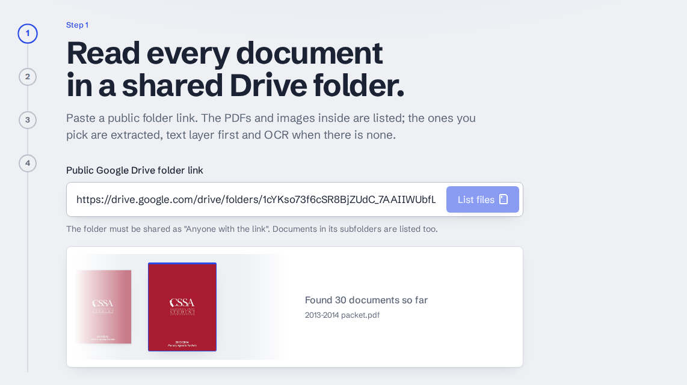

# Drive to Text

Paste a Google Drive folder link or choose private files, then extract text from the PDFs and
images. The app uses the text layer of native PDFs and runs OCR on images and scanned pages.

Built for the DI Xpertia technical assessment TA-2026-01.


## Features

- Accepts public folder links in the forms `/drive/folders/<id>`, `/drive/u/0/folders/<id>`,
  and `/open?id=<id>`, with or without `?usp=sharing`. Private folders require Google authorization.
- Lists the PDF, PNG and JPEG files in the folder and its subfolders.
- Processes the selected files in parallel, with live per-file progress. One failing file
  never stops the others.
- Detects scanned PDF pages and OCRs them automatically, page by page, so mixed documents work.
- OCR in English, French and Arabic, alone or combined.
- Shows the text, method, pages, characters and time for each file, and exports the batch as JSON, plain text or a ZIP archive.
- Shows Drive thumbnails and first-page previews as files are found. During extraction, the
  preview shows the current page and its extracted text. Results replace the file list when
  the batch finishes.
- Light and dark theme.



## Quick start

With Docker (includes Tesseract and the three language packs):

```bash
docker compose up --build       # http://localhost:8000
```

Or locally, with Python 3.11+ and [Tesseract](https://tesseract-ocr.github.io/tessdoc/Installation.html)
installed (`sudo apt install tesseract-ocr tesseract-ocr-fra tesseract-ocr-ara` on Ubuntu):

```bash
git clone https://github.com/AzizBahloul/Drive-to-Text-Document-Extraction-POC.git
cd Drive-to-Text-Document-Extraction-POC
python3 -m venv .venv && source .venv/bin/activate
pip install -e ".[dev]"
uvicorn app.main:app --reload   # http://127.0.0.1:8000
```

`make install`, `make dev`, `make test`, `make lint` and `make docker` run the same commands.
The API reference is at `/api/docs`.

## How it works

```
drive link -> list files -> select -> batch
   |- PDF          -> text layer, page by page
   |     page with text    -> kept as is                       (pdf-parser)
   |     page without text -> rendered at 300 dpi -> deskewed if needed -> Tesseract (ocr)
   `- PNG / JPEG   -> Tesseract                                (ocr)
results -> text per file, live status, JSON / TXT / ZIP export
```

A PDF whose pages all have text is reported as `pdf-parser`, an image or fully scanned PDF as
`ocr`, and a PDF with both kinds of pages as `mixed`.

```
app/
  drive/        link parsing, folder listing (with subfolders), download
  extraction/   router, pdf_parser (pypdfium2), ocr (Tesseract)
  batch/        in-memory batches, bounded concurrency, progress events
  api/          REST routes and Server-Sent Events stream
  static/       the single-page frontend (HTML, CSS, JavaScript, no build step)
```

| Part | Choice | Why |
| --- | --- | --- |
| Backend | Python, FastAPI | Runs the PDF and OCR pipeline, downloads files asynchronously, and streams progress. |
| PDF | pypdfium2 | Fast text extraction and page rendering in one permissively licensed package. |
| OCR | Tesseract 5 | Free, self-hosted, supports French, English and Arabic. |
| Frontend | Vanilla HTML, CSS, JS | One page, nothing to build. |
| Progress | Server-Sent Events | One-way live updates without a WebSocket library. |

## Google Drive access

- **No key (default):** reads the public folder page. Works out of the box, but sizes are not
  shown and large folders may show only the entries included in the public page.
- **Public Drive API:** Enable the Google Drive API in Google Cloud and set `GOOGLE_API_KEY` in
  `.env`. This enables paginated listing, file sizes and direct downloads. Folder scanning still
  follows the configured depth and folder limits.
- **Private folders:** Create a Google OAuth **Web application** client in a project with the
  Google Drive API enabled. Add the exact app origin, such as `http://127.0.0.1:8000`, to its
  authorized JavaScript origins. Set `GOOGLE_OAUTH_CLIENT_ID` and restart the app. If your consent
  screen is in testing mode, add the account as a test user. Choose **Connect private Drive**,
  then **Connect a private folder** and paste the folder link. Google requests the restricted
  `drive.readonly` scope so the app can list descendants of that folder.
- **Selected private files:** Enable the Google Picker API in the same project. Set
  `GOOGLE_PROJECT_NUMBER` to the numeric project number and `GOOGLE_PICKER_KEY` to a browser key.
  Restrict that key to the Drive and Picker APIs and allow referrers from the app origin and
  `https://docs.google.com/*`. Choose **Choose private files** for the narrower `drive.file`
  scope. Private previews appear after the app downloads the files.

The private Drive connection expires within one hour or when you choose **Disconnect Drive**.
Disconnecting clears your private batches from the server. Save any needed exports first. Folder and Picker authorization use short-lived
access tokens kept in server memory for the current browser session.

[Google OAuth setup](https://developers.google.com/identity/gsi/web/guides/get-google-api-clientid)
· [Google Picker setup](https://developers.google.com/workspace/drive/picker/guides/web-picker-sample)
· [Drive scopes](https://developers.google.com/workspace/drive/api/guides/api-specific-auth)

## Configuration

Everything is optional. Copy `.env.example` to `.env` to change it. The most useful settings:

| Variable | Default | Meaning |
| --- | --- | --- |
| `GOOGLE_API_KEY` | none | Use the Drive API instead of the public page |
| `MAX_FILE_SIZE_MB` | 25 | Larger files are refused |
| `MAX_PARALLEL_DOWNLOADS` | 4 | Simultaneous Drive downloads |
| `MAX_PARALLEL_FILES` | 2 | Simultaneous file extractions |
| `OCR_RENDER_DPI` | 300 | Scan render resolution, within the pixel limit |
| `OCR_DEFAULT_LANGUAGE` | eng | Preselected OCR language |
| `SUBFOLDER_DEPTH` | 3 | How deep subfolders are listed |
| `TESSDATA_DIR` | none | Folder with extra language packs, if not installed system-wide |

## Output

The **JSON** button calls `GET /api/batches/{id}/export` and returns a batch summary with
one entry per file. Use `?format=txt` for a single text file or `?format=zip` for a
manifest and individual text files. A JSON file entry looks like this:

```json
{
  "name": "contract.pdf", "status": "done", "method": "pdf-parser",
  "pages": [{ "page": 1, "method": "pdf-parser", "chars": 1834 }],
  "char_count": 1834, "duration_ms": 412, "error": null, "text": "…"
}
```

A full example is in [`samples/sample-output.json`](samples/sample-output.json).


## Tests

```bash
pytest
ruff check app tests && ruff format --check app tests
```

They cover link parsing, routing, scanned-page detection, the Drive client against a mocked
Google, the batch manager, the HTTP API and the safety limits. Test files are generated on the
fly, so no binary fixtures are stored.

## Security

Files come from folders the user does not control, so they are treated as untrusted: oversized
pages are rendered at a reduced scale, OCR and each file have time limits, and the number of
running batches is capped. The server only answers to allowed hosts, sends strict security
headers, and sends the server API key in a request header. Private results require the browser
session that created them. Docker publishes the app on `127.0.0.1` for local use.

## Limits

- Batches live in memory and are lost on restart.
- OCR quality depends on the scan. Handwriting, low resolution and skew are hard; Arabic is
  weaker than French or English, and tables come out as plain lines.
- Google Docs and Sheets are ignored; only PDF, PNG and JPEG are read.

## Licence

MIT, see [LICENSE](LICENSE). Third-party licences are listed in [LICENSES.md](LICENSES.md).
